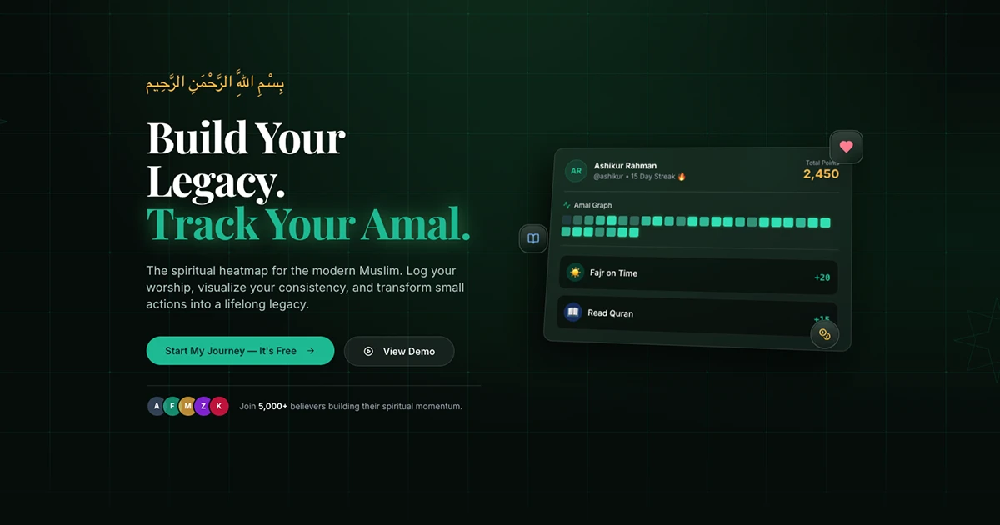

<div align="center">

# Hasanat

**Track your daily good deeds. See your consistency grow.**

<p>
  <a href="https://hasanat-3375b.web.app"><strong>Open the app</strong></a> ·
  <a href="#getting-started">Run it locally</a>
</p>

<p>
  
  
  
  
  
</p>

<a href="https://hasanat-3375b.web.app">
  
</a>

</div>

## Why?

Small good deeds are easy to start and hard to keep up. You pray Fajr on
time for a few days, read some Quran, then life gets busy and you lose
track. Most habit apps are not made for worship, so they don't know about
prayer times, the Hijri date or what counts as a good deed.

**Hasanat** (Arabic for "good deeds") is a habit tracker built for that. Log
what you did today, and a heatmap, like GitHub's contribution graph, shows
how consistent you have been. Seeing the streak is what keeps you going.

## Features

- **Daily deeds log**: tick off preset deeds (prayers, Quran, dhikr, charity
  and more) or add your own, and earn points for each.
- **Prayer checklist with real prayer times**: times come from your location
  through the AlAdhan API, with the current prayer highlighted.
- **Amal Graph**: a year heatmap, streaks, and week / month / year views with
  consistency per category.
- **Reminders**: push notifications for prayer times and short tips, sent by
  scheduled Cloud Functions in each user's own time zone.
- **Quran reader**: read by surah, with your progress and bookmarks saved to
  your account.
- **Leaderboard and profiles**: compare points with others and share a public
  profile.
- **Hijri and Bangla dates**, and the whole app in **English or Bangla**.
- **Install it like an app**: a Progressive Web App (PWA), so it sits on your
  home screen and opens without the browser bar, even on a slow connection.

## How it works

```
React app (Vite, PWA)
  ├─ TanStack Query ──► Firestore      deeds, logs, streaks, profiles
  ├─ AlAdhan API                        prayer times from your location
  └─ alquran.cloud API                  Quran text

Cloud Functions (scheduled)
  ├─ streakDailyEvaluate   closes each user's day in their time zone
  ├─ prayerReminderDispatch  push reminder at each prayer time
  └─ tipDispatch            tip notifications
```

- **Feature folders**: each area (`deeds`, `amal-graph`, `quran`,
  `leaderboard`...) lives in `src/features/` with its own components, hooks
  and types.
- **Server-side streaks**: a scheduled function closes each user's day in
  their own time zone, so streaks stay correct even when the app is closed.
- **Firestore security rules** (`firestore.rules`) let each user write only
  their own data.

## Tech stack

| Layer         | Tech                                                    |
| ------------- | ------------------------------------------------------- |
| UI            | React 18, TypeScript, Tailwind CSS, shadcn/ui, Framer Motion |
| Data          | TanStack Query, Firebase Auth, Firestore                |
| Backend       | Firebase Cloud Functions (scheduled), Cloud Messaging   |
| Charts        | Recharts                                                |
| App shell     | Vite, vite-plugin-pwa (Workbox)                         |
| Testing       | Vitest                                                  |
| Hosting       | Firebase Hosting                                        |

## Getting started

You need Node.js 20+ and a Firebase project (the free plan is enough for the
web app; scheduled functions need the Blaze plan).

```bash
git clone https://github.com/Ashikur540/hasanat.git
cd hasanat
npm install
cp .env.example .env   # fill in your Firebase web app config
npm run dev
```

Fill `.env` with the values from **Firebase console → Project settings →
Your apps → Web app**. `VITE_FIREBASE_VAPID_KEY` comes from **Cloud
Messaging → Web Push certificates** and is only needed for notifications.

To load the preset deeds into your Firestore, download a service account key
(**Project settings → Service accounts**), save it as `serviceAccount.json`
in the project root (it is gitignored), then run:

```bash
npm install --no-save firebase-admin
GOOGLE_APPLICATION_CREDENTIALS=./serviceAccount.json node scripts/seed-deeds.mjs
```

### Scripts

| Command                    | What it does                          |
| -------------------------- | ------------------------------------- |
| `npm run dev`              | Start the dev server                  |
| `npm run build`            | Production build                      |
| `npm run preview`          | Serve the production build locally    |
| `npm run lint`             | ESLint                                |
| `npm test`                 | Run the tests once (Vitest)           |
| `npm run deploy`           | Build and deploy to Firebase Hosting  |
| `npm run deploy:functions` | Deploy the Cloud Functions            |

### Install on your phone

- **Android / Chrome**: open the app, then **Settings → Install App**, or use
  the browser's install prompt.
- **iPhone / Safari**: tap **Share → Add to Home Screen**.

## Author

Built by **Ashikur Rahman**, a frontend-focused full-stack developer.
[GitHub](https://github.com/Ashikur540) ·
[LinkedIn](https://linkedin.com/in/md-ashikurrahman)

If Hasanat helps you, a ⭐ helps others find it.
